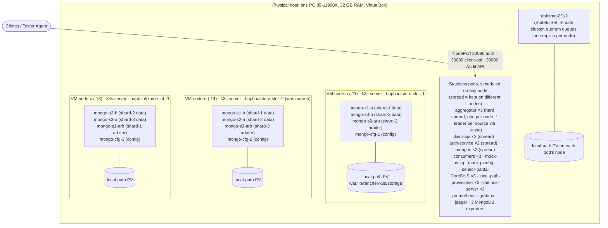

# Deployment diagram (demo: 3 VMs)

Physical host → VM / Kubernetes node → pod → node-local disk. The logical architecture diagram in the report does not replace this one.
Current demo cluster (verified on the real VMs): `node-a` 192.168.56.11, `node-c` 192.168.56.13, `node-d` 192.168.56.14. All three are k3s **servers**
(control-plane + embedded etcd, 3 members) and also run workloads. `node-b` existed at the start and was replaced by `node-d` after its loss (P1 criterion 5).
Placement source of truth: `k8s/store/layout.json` (store members per slot) and `scripts/k8s/label-nodes.sh` (slot → node).

## Traffic paths (all inside namespace `sistem-informasi-kebencanaan-bnpb`)

| From | To (Service DNS : port) | Protocol | Allowed by |
|---|---|---|---|
| Clients | any node `:30090` → `auth-service:8090` (ClientIP affinity) | HTTP | NodePort |
| Clients | any node `:30080` → `client-api:8080` | HTTP + JWT RS256 | NodePort |
| Assistants / Tester | any node `:30000` → `aggregator-audit:3001` | HTTP + Bearer audit token | NodePort |
| client-api | `aggregator:3000` (`/internal/*`) | HTTP | NetworkPolicy: client-api only |
| aggregator | `mock-bmkg:8081`, `mock-pvmbg:8082`, `sensor-pantai:8080` | HTTP | NetworkPolicy |
| aggregator | `satellite.naufarrel.dev:443` (SSE, only when the satellite token is set) | HTTPS | egress is not restricted |
| aggregator | `mongos-direct` (SRV name, both mongos pods; `mongos:27017` ClusterIP kept for the init container and tools) | MongoDB wire, keyfile auth between members | NetworkPolicy: `role=aggregator` only |
| aggregator | `mongo-s*-*-0.<member>:27017` directly | MongoDB wire (probe user) | NetworkPolicy: placement probes, degraded scans |
| mongos | config RS `cfg` + shard RSs `s1`/`s2`/`s3` | MongoDB wire | store-ingress policy |
| aggregator, consumers | `rabbitmq:5672` | AMQP | NetworkPolicy |
| all services | `jaeger:4318` | OTLP/HTTP | allow-otlp-to-jaeger |
| prometheus | pod `/metrics`, kubelet cAdvisor | HTTP | allow-prometheus-scrape |

Cross-node traffic: every shard replicates between its two data members, which are always on two **different** VMs (oplog over
27017). Arbiters vote only. Pods reach each other through the k3s overlay network (flannel VXLAN); NodePorts work on every node.

## What a lost VM takes with it

- **Store:** one data member of two shards and one arbiter. Every shard keeps one readable data member, so reads stay complete.
  Writes to those shards are acknowledged `degraded` until re-sync. The disk is node-local, so a replacement starts empty and
  re-syncs (`scripts/k8s/p1-replace-node.sh`).
- **Stateless pods:** rescheduled after about 70 s (20 s eviction toleration in the demo overlay). Copies that exist twice keep serving.
- **Aggregator:** 3 replicas on 3 nodes. The leader of each source (Lease with a 20 s duration) hands over in about 20 s; the other pods keep serving
  reads. Dead-node detection was tuned from about 48 s to about 16 s (`scripts/k8s/tune-failure-detection.sh`).
- **RabbitMQ:** a 3-node cluster with quorum queues, so one lost node does not lose acknowledged messages. A StatefulSet never starts a second
  copy of a pod it cannot confirm is gone, so the lost member's pod stays `Pending` until the node returns or is replaced.
- **DNS:** CoreDNS runs one replica per node (`scripts/k8s/harden-platform.sh`); with a single replica a node loss broke all service lookups for minutes.
